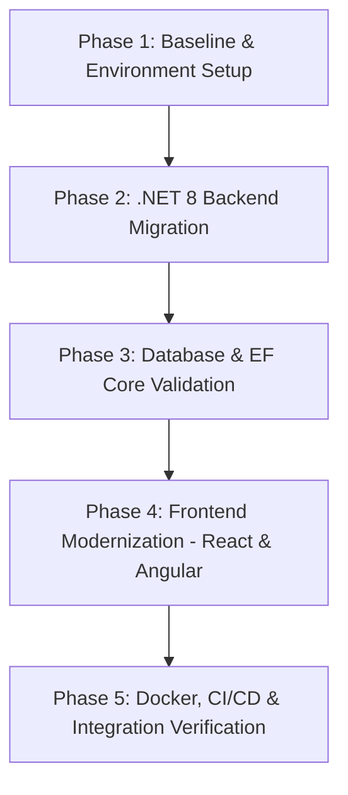

# ButsPosDotnet6 - Tech Stack Breakdown & Comprehensive Modernization Plan

*Prepared by: Principal Full-Stack .NET & Frontend Architect*

This document provides a technical inventory, target upgrade definition, breaking changes analysis, and a step-by-step phased migration plan for modernizing the `ButsPosDotnet6` application stack.

---

## 1. Technical Inventory

### 1.1 Project Architecture & Layer Breakdown
The target system architecture for `ButsPosDotnet6` follows a standard Clean Architecture / Onion Architecture pattern:
* **Backend API Layer (`src/API`)**: ASP.NET Core Web API / Minimal API host, Dependency Injection entry point, Controllers, Middleware, CORS, OpenAPI/Swagger configuration.
* **Core / Domain Layer (`src/Core`)**: Domain Entities, Value Objects, Domain Events, Repository Interfaces, Business Rules.
* **Application Layer (`src/Application`)**: CQRS Handlers (MediatR), DTOs, Mappers (AutoMapper), Request Validation (FluentValidation), Service Interfaces.
* **Infrastructure Layer (`src/Infrastructure`)**: Entity Framework Core `DbContext`, Data Persistence, Database Migrations, SQL Server / PostgreSQL Provider, Authentication/JWT Bearer Token Generation, External Services Integration.
* **Frontend Admin Dashboard (`src/Clients/Admin`)**: React SPA for administrative tasks, product catalog management, user role assignments, and sales reporting.
* **Frontend Client / Shop (`src/Clients/Shop`)**: Angular SPA for point-of-sale customer checkout, product browsing, cart management, and order processing.

### 1.2 Version Matrix & Dependencies Baseline

| Component / Dependency | Current Version (Baseline) | Target Version | End-of-Life (EOL) Status / Urgency |
| :--- | :--- | :--- | :--- |
| **Backend Runtime** | `.net6.0` (C# 10) | **`.net8.0` LTS** *(or `.net9.0`)* | **EOL (Nov 12, 2024)** — Critical Security & Maintenance Upgrade |
| **EF Core Provider** | `Microsoft.EntityFrameworkCore.SqlServer` `6.0.x` | `8.0.x` / `9.0.x` | **EOL** — Needs upgrade for security & performance |
| **EF Core Tools** | `Microsoft.EntityFrameworkCore.Tools` `6.0.x` | `8.0.x` / `9.0.x` | **EOL** — CLI tooling upgrade required |
| **JWT Authentication** | `Microsoft.AspNetCore.Authentication.JwtBearer` `6.0.x` | `8.0.x` / `9.0.x` | **EOL** — Token validation hardening required |
| **Identity Management** | `Microsoft.AspNetCore.Identity.EntityFrameworkCore` `6.0.x` | `8.0.x` / `9.0.x` | **EOL** — Identity API Endpoint support available in 8+ |
| **CQRS / MediatR** | `MediatR` `10.x` / `11.x` | `12.x` | Legacy pipeline behavior changes |
| **Object Mapper** | `AutoMapper` `11.x` | `13.x` | Mapper configuration & DI updates |
| **Validation** | `FluentValidation` `11.x` | `11.9+` | Validator auto-validation deprecations |
| **API Docs** | `Swashbuckle.AspNetCore` `6.x` | `Microsoft.AspNetCore.OpenApi` + `Scalar` / `Swashbuckle 6.5+` | Swashbuckle maintenance inactive; migration recommended |
| **Admin Frontend** | React `17.x` / `18.x` (CRA) | **React 19** + **Vite 6** | CRA is deprecated; transition to Vite build tool |
| **Client Frontend** | Angular `13.x` – `16.x` | **Angular 19** | Legacy View Engine / NgModules transitioning to Standalone & Signals |
| **TypeScript** | TypeScript `4.x` | TypeScript `5.x` | Performance and type narrowing improvements |
| **Database Engine** | SQL Server 2019 / PostgreSQL 14 | SQL Server 2022 / PostgreSQL 16 | Supported |
| **Containerization** | `mcr.microsoft.com/dotnet/aspnet:6.0` | `mcr.microsoft.com/dotnet/aspnet:8.0` | Base images EOL |

---

## 2. Target Upgrade Definition & EOL Summary

1. **Immediate EOL Remediation (.NET 6.0)**:
   - .NET 6 reached End of Life on **November 12, 2024**. Security patches are no longer provided by Microsoft.
   - Upgrading to **.NET 8.0 LTS** ensures support through **November 2026** with optional upgrade paths to .NET 9.

2. **Frontend Modernization**:
   - **React Admin**: Replace deprecated Create React App (`react-scripts`) with **Vite**, upgrade React to **v19**, and leverage new hooks (`useActionState`, `useOptimistic`).
   - **Angular Client**: Sequentially upgrade Angular CLI from v13/v16 through to **v19**, adopt **Standalone Components** by default, and migrate template control flow to `@if` / `@for`.

---

## 3. Breaking Changes & Deprecation Analysis

### 3.1 Backend & .NET Runtime Breaking Changes
* **EF Core Breaking Changes (6.0 -> 8.0/9.0)**:
  - *Client vs. Server Evaluation*: Stricter LINQ parsing; non-translatable expressions will throw `InvalidOperationException` rather than evaluating client-side.
  - *ExecuteUpdate / ExecuteDelete*: Replaces manual bulk SQL/iteration with native batch operations (`ExecuteUpdateAsync`, `ExecuteDeleteAsync`).
  - *JSON Columns*: Native mapping via `.ToJson()` support for complex owned types.
* **Minimal API & ASP.NET Core**:
  - `WebApplicationBuilder` host bootstrapping replaces legacy `Startup.cs` patterns.
  - OpenAPI generation moving towards native `Microsoft.AspNetCore.OpenApi` and `Scalar.AspNetCore` UI middleware.
* **MediatR v12 Breaking Changes**:
  - Registration syntax updated (`builder.Services.AddMediatR(cfg => cfg.RegisterServicesFromAssembly(...))`).

### 3.2 Frontend Breaking Changes
* **React 18 / 19 Transition**:
  - Concurrent rendering defaults; `ReactDOM.render` removed in favor of `createRoot`.
  - Deprecated lifecycle methods removed.
* **Angular 13/16 -> 19 Transition**:
  - `ViewEngine` completely removed in favor of Ivy runtime.
  - Default routing, components, and directives transition from `NgModules` to **Standalone Components**.
  - Directives like `*ngIf` and `*ngFor` replaced with native control flow syntax (`@if (...) { }`, `@for (...) { }`).

---

## 4. Phased Upgrade Plan



---

### Phase 1: Pre-requisites & Baseline Verification

#### Steps:
1. **Repository & Branching Setup**:
   ```bash
   git checkout -b upgrade/dotnet8-modernization
   ```
2. **Environment Verification**:
   Verify installed SDKs:
   ```bash
   dotnet --list-sdks
   node -v
   npm -v
   ```
   *Required Tools:* .NET 8 SDK (`8.0.x`), Node.js LTS (`v20.x` or `v22.x`).

3. **Database Backup**:
   Take a snapshot of the local development database before applying migration changes.

* **Risk Factors**: Uncommitted local changes or inconsistent Node/SDK environments.
* **Rollback Strategy**: `git checkout main` and restore database snapshot.

---

### Phase 2: Backend Runtime & NuGet Dependency Migration

#### Steps:
1. **Target Framework Update**:
   Update all `.csproj` files (`API`, `Core`, `Infrastructure`, `Application`, `Tests`) to target `net8.0`:
   ```xml
   <PropertyGroup>
     <TargetFramework>net8.0</TargetFramework>
     <Nullable>enable</Nullable>
     <ImplicitUsings>enable</ImplicitUsings>
   </PropertyGroup>
   ```

2. **Package Upgrades**:
   Execute NuGet upgrades for core packages:
   ```bash
   dotnet add src/Infrastructure package Microsoft.EntityFrameworkCore.SqlServer --version 8.0.*
   dotnet add src/Infrastructure package Microsoft.EntityFrameworkCore.Tools --version 8.0.*
   dotnet add src/API package Microsoft.AspNetCore.Authentication.JwtBearer --version 8.0.*
   dotnet add src/Application package MediatR --version 12.*
   dotnet add src/Application package AutoMapper --version 13.*
   ```

3. **Compilation & Unit Tests**:
   ```bash
   dotnet build
   dotnet test
   ```

* **Risk Factors**: Breaking API changes in third-party libraries (MediatR v12 DI registration changes).
* **Rollback Strategy**: Revert `.csproj` changes via `git checkout -- "*.csproj"`.

---

### Phase 3: Database Migrations & EF Core Behavior Validation

#### Steps:
1. **EF Core Migration Script Generation**:
   ```bash
   dotnet ef migrations add MigrateToDotnet8EFCore --project src/Infrastructure --startup-project src/API
   ```
2. **Apply Migrations**:
   ```bash
   dotnet ef database update --project src/Infrastructure --startup-project src/API
   ```
3. **LINQ & Query Evaluation Verification**:
   Execute integration tests to ensure no query translation failures occur due to client-side evaluation restrictions.

* **Risk Factors**: Incompatible shadow state properties or SQL translation breaking changes.
* **Rollback Strategy**: `dotnet ef database update <previous-migration-name>`.

---

### Phase 4: Frontend Upgrades (Admin & Client Interfaces)

#### 4.1 React Admin Dashboard Upgrade (CRA -> Vite & React 19)
1. **Install Dependencies**:
   ```bash
   cd src/Clients/Admin
   npm install react@latest react-dom@latest
   npm install -D vite @vitejs/plugin-react
   ```
2. **Migrate Bundler**:
   Replace `react-scripts` commands in `package.json` with `vite`:
   ```json
   "scripts": {
     "dev": "vite",
     "build": "tsc && vite build",
     "preview": "vite preview"
   }
   ```
3. **Verify Build**:
   ```bash
   npm run build
   ```

#### 4.2 Angular Client Upgrade (Sequential Upgrade to Angular 19)
1. **Sequential CLI Migration**:
   ```bash
   cd src/Clients/Shop
   # Sequential upgrade step-by-step per major version:
   npx @angular/cli@17 update @angular/core@17 @angular/cli@17
   npx @angular/cli@18 update @angular/core@18 @angular/cli@18
   npx @angular/cli@19 update @angular/core@19 @angular/cli@19
   ```
2. **Run Automated Code Transformations**:
   ```bash
   # Migrate template control flow (@if / @for)
   ng generate @angular/core:control-flow
   # Migrate components to Standalone
   ng generate @angular/core:standalone
   ```
3. **Verify Build & Run Tests**:
   ```bash
   ng build
   ng test --watch=false
   ```

* **Risk Factors**: Incompatible third-party UI component libraries (e.g., legacy Bootstrap or Angular Material wrappers).
* **Rollback Strategy**: Revert `package.json` and `package-lock.json` via git.

---

### Phase 5: Docker, CI/CD, and Integration Verification

#### Steps:
1. **Update `Dockerfile`**:
   ```dockerfile
   FROM mcr.microsoft.com/dotnet/aspnet:8.0 AS base
   WORKDIR /app
   EXPOSE 80
   EXPOSE 443

   FROM mcr.microsoft.com/dotnet/sdk:8.0 AS build
   WORKDIR /src
   COPY ["src/API/API.csproj", "src/API/"]
   RUN dotnet restore "src/API/API.csproj"
   COPY . .
   WORKDIR "/src/src/API"
   RUN dotnet build "API.csproj" -c Release -o /app/build

   FROM build AS publish
   RUN dotnet publish "API.csproj" -c Release -o /app/publish /p:UseAppHost=false

   FROM base AS final
   WORKDIR /app
   COPY --from=publish /app/publish .
   ENTRYPOINT ["dotnet", "API.dll"]
   ```

2. **Update CI/CD GitHub Actions (`.github/workflows/ci.yml`)**:
   ```yaml
   name: CI/CD Pipeline

   on:
     push:
       branches: [ main, upgrade/dotnet8-modernization ]
     pull_request:
       branches: [ main ]

   jobs:
     build-and-test:
       runs-on: ubuntu-latest
       steps:
         - uses: actions/checkout@v4

         - name: Setup .NET
           uses: actions/setup-dotnet@v4
           with:
             dotnet-version: '8.0.x'

         - name: Setup Node.js
           uses: actions/setup-node@v4
           with:
             node-version: '20.x'

         - name: Restore & Build .NET Backend
           run: |
             dotnet restore
             dotnet build --no-restore -c Release

         - name: Run Backend Tests
           run: dotnet test --no-build -c Release

         - name: Build React Admin
           run: |
             cd src/Clients/Admin
             npm ci
             npm run build

         - name: Build Angular Client
           run: |
             cd src/Clients/Shop
             npm ci
             npm run build
   ```

3. **End-to-End Verification Checklist**:
   - [ ] JWT authentication issuing and renewal across both clients.
   - [ ] POS Product Search, Filtering, and Inventory updates.
   - [ ] Cart calculations and Checkout processing.
   - [ ] Docker container build and container execution test (`docker compose up`).

* **Risk Factors**: Container architecture differences or CI build runner environment issues.
* **Rollback Strategy**: Revert Dockerfile and workflow pipeline changes.
