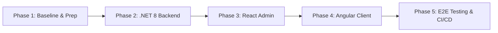

# ButsPosDotnet6 - Tech Stack Breakdown & Modernization Plan

This document outlines the current technology stack of the `ButsPosDotnet6` repository, identifies target stable versions, and details a phased migration strategy to modernize the backend, frontends, database layer, and deployment pipelines.

---

## 1. Tech Stack & Version Matrix

| Component / Layer | Repository Baseline | Recommended Target | Motivation & Benefits |
| :--- | :--- | :--- | :--- |
| **Backend Runtime** | .NET 6.0 (C# 10) | **.NET 8.0 LTS** *(or .NET 9.0)* | .NET 6 is End-of-Life (EOL). .NET 8 LTS provides long-term security fixes, C# 12 features, enhanced JIT throughput, and reduced memory footprint. |
| **ORM / Data Access** | EF Core 6.x | **EF Core 8.x** | Improved LINQ translation, native JSON column support, performance optimizations, and native batch operations (`ExecuteUpdateAsync` / `ExecuteDeleteAsync`). |
| **API Documentation** | Swashbuckle / Swagger 6.x | **Microsoft.AspNetCore.OpenApi** / Scalar or Swashbuckle 6.5+ | Modern OpenAPI generation, cleaner minimal API integration, and improved developer tooling. |
| **Admin Frontend** | React 17 / 18 | **React 19** | Modern hooks (`useActionState`, `useOptimistic`), asset preloading, and transition to Vite if currently on Create React App (CRA). |
| **Client / Shop Frontend** | Angular (v13–v16) | **Angular 19 / 20** | Standalone component defaults, Signals reactivity, new built-in control flow (`@if`, `@for`), and esbuild-based build pipeline. |
| **Authentication & Auth** | ASP.NET Identity / JWT 6.x | **JWT Bearer 8.x** / Identity API endpoints | Hardened token validation and streamlined Identity endpoints. |

---

## 2. Phased Upgrade Plan



### Phase 1: Baseline Preparation & Environment Setup
1. **Branching**:
   Create a dedicated migration branch:
   ```bash
   git checkout -b upgrade/dotnet8-modern-stack
   ```
2. **Local SDKs**:
   - Install .NET 8 SDK (or latest LTS).
   - Install Node.js LTS (v20+ / v22+).
3. **Database Snapshot**:
   - Take a backup of the current development database.
   - Verify that all current migrations run successfully from scratch on a clean instance.

---

### Phase 2: Backend & Data Access Modernization (.NET 8 LTS)

1. **Target Framework Updates**:
   Update all `.csproj` files (`API`, `Core`, `Infrastructure`, `Application`, `Tests`) from `net6.0` to `net8.0`:
   ```xml
   <PropertyGroup>
     <TargetFramework>net8.0</TargetFramework>
     <Nullable>enable</Nullable>
     <ImplicitUsings>enable</ImplicitUsings>
   </PropertyGroup>
   ```

2. **NuGet Package Upgrades**:
   Update core Microsoft packages to their matching 8.x versions:
   ```bash
   dotnet add package Microsoft.EntityFrameworkCore.SqlServer --version 8.0.*
   dotnet add package Microsoft.EntityFrameworkCore.Tools --version 8.0.*
   dotnet add package Microsoft.AspNetCore.Authentication.JwtBearer --version 8.0.*
   ```
   Check third-party dependencies (`AutoMapper`, `MediatR`, `FluentValidation`, `Newtonsoft.Json` / `System.Text.Json`) for breaking changes and upgrade them to versions supporting .NET 8.

3. **Code & Configuration Adjustments**:
   - **EF Core Breaking Changes**: Review client-side vs. server-side query evaluation warnings.
   - **Program.cs**: Simplify dependency injection registrations using modern hosting extensions.
   - Run tests:
     ```bash
     dotnet test
     ```

---

### Phase 3: React Admin Dashboard Modernization

1. **Audit Dependencies**:
   Navigate to the React application directory and inspect installed packages:
   ```bash
   npm outdated
   ```
2. **Core Library Upgrade**:
   Update React and React DOM:
   ```bash
   npm install react@latest react-dom@latest
   ```
3. **Bundler Migration (if using CRA)**:
   - If using `react-scripts` (Create React App), migrate to **Vite** for significantly faster startup and Hot Module Replacement (HMR).
   - Ensure routers (e.g., `react-router-dom` v6+) and state management stores (Redux Toolkit/Zustand) function without deprecation warnings.

---

### Phase 4: Angular Client Frontend Modernization

1. **Sequential Version Upgrade**:
   Do not skip multiple major versions at once. Upgrade one major version at a time using Angular CLI:
   ```bash
   # Example: Upgrading sequentially to current version
   npx @angular/cli@<target-version> update @angular/core@<target-version> @angular/cli@<target-version>
   ```
2. **Adopt Modern Angular Patterns**:
   - Run the automated control flow migration tool:
     ```bash
     ng generate @angular/core:control-flow
     ```
   - Convert legacy modules to **Standalone Components** where applicable:
     ```bash
     ng generate @angular/core:standalone
     ```
   - Update `angular.json` to utilize the modern `application` builder (esbuild-based).

---

### Phase 5: Integration, Verification & CI/CD

1. **Authentication & Integration Testing**:
   - Verify JWT issuance and expiration handling across both frontends.
   - Validate CORS configuration between API endpoints and both web clients.
2. **Core POS Business Logic Verification**:
   - Product catalog search and filtering.
   - Cart calculations, tax computations, and discounts.
   - Checkout flow and inventory balance deduction.
   - Receipt and invoice generation/export.
3. **Containerization & CI/CD**:
   - Update `Dockerfile` base images:
     ```dockerfile
     FROM mcr.microsoft.com/dotnet/aspnet:8.0 AS base
     FROM mcr.microsoft.com/dotnet/sdk:8.0 AS build
     ```
   - Update GitHub Actions workflows to use setup-dotnet with `.NET 8` and Node with `20.x` or `22.x`.
